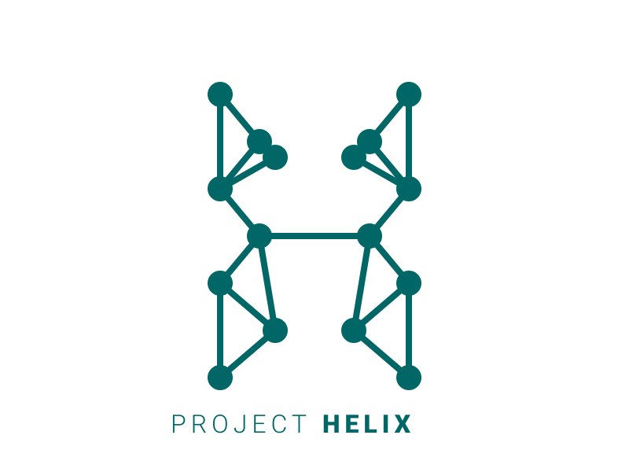

# 🧪 Project Helix

<p align="center">
  
</p>

<p align="center">
  <strong>A data-science project exploring the chemical elements through data.</strong>
</p>

<p align="center">
  
  
  
  
</p>

---

## 📖 About

**Project Helix** is a personal data-science and software project focused on building, validating, documenting, and eventually analyzing structured data about the chemical elements.

The project is being developed publicly with an emphasis on **understanding the data and the code behind it**, rather than simply producing an end result.

Helix is intentionally being built step-by-step:

> **Data → Validation → Documentation → Understanding → Analysis → Modeling**

---

## 🚧 Current Status

### Dataset v1.1 — ✅ Released

Dataset v1.1 resolves the missing values from v1 using a two-tier approach:

* **Experimentally verified values** filled for all stable and well-characterised elements
* **Theoretically predicted values** (clearly labelled) filled for synthetic heavy elements (Z ≥ 100) where no bulk sample exists
* **Intentionally blank** cells retained where values are genuinely undefined (e.g. Pauling electronegativity for He/Ne/Ar)

| Metric | v1 | v1.1 |
|--------|----|------|
| Populated cells | 1,674 / 1,770 | 1,727 / 1,770 |
| Completeness | 94.6% | **97.6%** |
| EXP fills | — | 20 |
| THEO fills | — | 36 |
| Intentionally blank | — | 43 |

**Dataset status:** `v1.1 — Values Resolved`

See [docs/dataset-v1-1-changelog.md](docs/dataset-v1-1-changelog.md) for a full per-cell audit trail.

### Dataset v1 — ✅ Complete (archived)

The original v1 dataset:

* **118 chemical elements** · **15 features**
* JSON → pandas DataFrame → CSV pipeline
* Automated structural validation, missing-value analysis, source/provenance coverage validation
* **Status:** `Initial / Raw` — no imputation

---

## 🎯 Project Goals

Helix is being developed through several stages:

1. Build a structured dataset of all chemical elements.
2. Understand and document every feature.
3. Audit data provenance and quality.
4. Perform exploratory data analysis.
5. Identify meaningful relationships and patterns.
6. Build software tools around the dataset.
7. Explore appropriate data-science and machine-learning applications.

The primary goal is **data quality and understanding before modeling**.

---

# 📊 Dataset

## Dataset v1

| Property        |             Value |
| --------------- | ----------------: |
| Elements        |           **118** |
| Features        |            **15** |
| Version         |            **v1** |
| Status          | **Initial / Raw** |
| Missing values  |        Documented |
| Imputation      |              None |
| Source coverage |         118 / 118 |

---

## 🔬 Features

| Feature                     | Description                                            |
| --------------------------- | ------------------------------------------------------ |
| `number`                    | Atomic number                                          |
| `symbol`                    | Chemical symbol                                        |
| `name`                      | Element name                                           |
| `atomic_mass`               | Atomic mass value provided by the source dataset       |
| `category`                  | Element classification/category                        |
| `period`                    | Periodic-table period                                  |
| `group`                     | Periodic-table group                                   |
| `block`                     | Periodic-table block                                   |
| `density`                   | Density value provided by the source dataset           |
| `melt`                      | Melting-point value provided by the source dataset     |
| `boil`                      | Boiling-point value provided by the source dataset     |
| `molar_heat`                | Molar heat value provided by the source dataset        |
| `electron_affinity`         | Electron-affinity value provided by the source dataset |
| `electronegativity_pauling` | Pauling electronegativity value                        |
| `electron_configuration`    | Electron configuration                                 |

> **Note:** Feature definitions, units, and property-level provenance are still being formally audited.

---

# 🔬 Data Pipeline

```text
PeriodicTableJSON.json
          │
          ▼
        Python
          │
          ▼
   Filter elements
   atomic number ≤ 118
          │
          ▼
    pandas DataFrame
          │
          ▼
    Select 15 features
          │
          ▼
   Data-quality checks
          │
          ▼
      Dataset v1
          │
          ▼
          CSV
```

---

# ✅ Data Quality

Helix currently performs automated checks for:

### Dataset Structure

* Exactly **118 elements**
* Exactly **15 selected features**
* Atomic numbers `1 → 118`

### Uniqueness

The following fields must contain 118 unique values:

* `number`
* `symbol`
* `name`

### Periodic Table Structure

* `period` must be between `1` and `7`
* `group` must be between `1` and `18`
* `block` must be one of:

  * `s`
  * `p`
  * `d`
  * `f`

### Required Values

* `atomic_mass` must be greater than zero
* `symbol` must not be missing
* `name` must not be missing

### 📈 Accuracy & Validation Scorecard

| Check Category | Target | Result | Pass Rate |
|---|---|---|:---:|
| **Element Count** | 118 chemical elements | 118 elements | **100% PASS** |
| **Atomic Sequence** | Continuous range 1 → 118 | 0 gaps, 0 duplicates | **100% PASS** |
| **Identifier Uniqueness** | `number`, `symbol`, `name` | All distinct | **100% PASS** |
| **Periodic Structure** | Periods 1–7, Groups 1–18, Blocks s/p/d/f | 100% valid | **100% PASS** |
| **Thermodynamic Law** | $T_{\text{melt}} \le T_{\text{boil}}$ | 102/102 pairs | **100% PASS** |
| **Physical Value Bounds** | Mass, Density, Temperatures $> 0$ | 0 violations | **100% PASS** |
| **Source Provenance** | Unique Wikipedia URLs | 118 unique HTTPS URLs | **100% PASS** |
| **Data Completeness** | 1,770 total feature cells | 1,674 populated (94.6%) | **Unimputed** |

> For the comprehensive verification methodology and physical rationales, see [docs/data-quality-report.md](docs/data-quality-report.md).

---

# 📉 Missing Values

## Dataset v1.1 (Current)

After the v1.1 resolution pass, remaining blanks are intentional:

| Feature                     | v1 Missing | v1.1 Missing | Status |
| --------------------------- | ---------: | -----------: |--------|
| `density`                   |          4 |            0 | ✅ Resolved |
| `melt`                      |         11 |            0 | ✅ Resolved |
| `boil`                      |         14 |            0 | ✅ Resolved |
| `molar_heat`                |         40 |           15 | ⚠ Partial — Z≥104 blank (no data) |
| `electron_affinity`         |          9 |           10 | ⚠ Slight increase — superheavy blanks retained |
| `electronegativity_pauling` |         18 |           18 | ⚠ He/Ne/Ar + Z≥104 intentionally undefined |

### Resolution Policy for v1.1

Values were filled according to a strict hierarchy:

1. **EXP** — Experimentally measured values from NIST, IUPAC, or RSC sources
2. **THEO** — Theoretically predicted values from peer-reviewed relativistic QM calculations
3. **INTERP** — Interpolated from well-characterised periodic neighbours
4. **CONV** — Convention-derived (e.g. ideal-gas Cp = 5/2·R for monatomic noble gases)
5. **Left blank** — Value is genuinely undefined or no reliable source exists

See [docs/dataset-v1-1-changelog.md](docs/dataset-v1-1-changelog.md) for the full per-cell audit.

## Dataset v1 (Archived)

| Feature                     | Missing | Percentage |
| --------------------------- | ------: | ---------: |
| `density`                   |       4 |       3.4% |
| `melt`                      |      11 |       9.3% |
| `boil`                      |      14 |      11.9% |
| `molar_heat`                |      40 |      33.9% |
| `electron_affinity`         |       9 |       7.6% |
| `electronegativity_pauling` |      18 |      15.3% |

---

# 🔗 Source & Provenance

The initial dataset was derived from a periodic-table JSON dataset.

Every element record contains a `source` field.

Current validation has established:

* **118 / 118** elements have a source entry.
* **118 / 118** source URLs are unique.
* Each source points to the corresponding element's Wikipedia page.

### ⚠️ Important

An element-level source URL does **not** automatically mean that every individual property has been independently verified against that source.

Property-level provenance is therefore still under investigation.

---

# 🧪 Known Data Concerns

Current concerns include:

* Some properties have substantial missingness.
* Property-level provenance has not yet been fully audited.
* Feature definitions and units need to be formally documented.
* Heavy and synthetic elements require particular attention.
* The original source dataset should not automatically be treated as authoritative for every individual property.

These limitations are intentionally documented rather than hidden.

---

# 🗺️ Roadmap

## Phase 1 — Dataset v1 ✅

* [x] Obtain initial element dataset
* [x] Parse JSON
* [x] Build pandas DataFrame
* [x] Select 15 features
* [x] Validate 118 elements
* [x] Validate identifiers
* [x] Validate periodic-table structure
* [x] Analyze missing values
* [x] Document data-quality concerns
* [x] Validate source coverage

## Phase 2 — Data Verification ✅

* [x] Investigate missing values — root causes documented
* [x] Resolve missing values (EXP → THEO → INTERP → CONV)
* [x] Release Dataset v1.1 with full per-cell audit trail
* [x] Document all fills in [dataset-v1-1-changelog.md](docs/dataset-v1-1-changelog.md)
* [ ] Build complete data dictionary with formal feature definitions
* [ ] Document units and measurement conventions for all features
* [ ] Full property-level provenance audit
* [ ] Identify remaining inconsistencies (e.g. C and As phase anomalies)

## Phase 3 — Exploratory Data Analysis

* [ ] Statistical summaries
* [ ] Distribution analysis
* [ ] Correlation analysis
* [ ] Data visualizations
* [ ] Investigate relationships between chemical properties

## Phase 4 — Helix Software 🚀

* [x] Create reusable data-loading layer (`src/dataset.py`)
* [x] Build a Python API (`HelixDataset` class)
* [x] Expose validated element data
* [x] Create API documentation

### Quickstart & API Usage

```python
from src import HelixDataset, load_dataset

# Load dataset as pandas DataFrame
df = load_dataset()

# Or use the HelixDataset API
ds = HelixDataset()

# Quick lookup by symbol, atomic number, or name
iron = ds.get("Fe")
print(f"{iron['name']}: mass={iron['atomic_mass']}, period={iron['period']}, block={iron['block']}")

# Filter by periodic structure
halogens = ds.filter(group=17)
d_block = ds.filter(block="d")

# View missing values analysis
print(ds.missing_summary())
```

## Phase 5 — Data Science

* [ ] Identify meaningful analytical questions
* [ ] Feature engineering
* [ ] Statistical modeling
* [ ] Explore suitable machine-learning applications
* [ ] Evaluate models rigorously

---

# 🛠️ Tech Stack

| Technology | Purpose                        |
| ---------- | ------------------------------ |
| **Python** | Data processing and validation |
| **pandas** | Data manipulation and analysis |
| **JSON**   | Initial dataset format         |
| **CSV**    | Dataset v1 storage             |
| **Git**    | Version control                |
| **GitHub** | Public development             |

Additional technologies will be introduced only when they serve a clear purpose.

---

# 📁 Project Structure

```text
Project-Helix/
│
├── src/
│   └── PeriodicTableJSON.json
│
├── data/
│   └── dataset_v1.csv
│
├── docs/
│   ├── data-quality-report.md
│   └── status.md
│
├── README.md
├── requirements.txt
└── ...
```

The project structure will evolve as Helix develops.

---

# 🧠 Philosophy

Helix follows one central principle:

> **Understand the data before trying to model it.**

Machine learning is not the starting point.

A model built on poorly understood or poorly documented data can produce impressive-looking results while being fundamentally unreliable.

Therefore, Helix prioritizes:

```text
DATA
  ↓
VALIDATION
  ↓
DOCUMENTATION
  ↓
UNDERSTANDING
  ↓
ANALYSIS
  ↓
MODELING
```

---

# 📌 Dataset Status

| Field                     | Status                                 |
| ------------------------- | -------------------------------------- |
| Version                   | **Dataset v1.1**                       |
| Elements                  | **118**                                |
| Features                  | **15**                                 |
| Status                    | **Values Resolved**                    |
| Completeness              | **97.6%** (1,727 / 1,770 cells)        |
| Experimental fills        | **20**                                 |
| Theoretical fills         | **36**                                 |
| Intentionally blank       | **43** (undefined or no data)          |
| Source coverage           | **Validated**                          |
| Property-level provenance | **Partially audited** (v1.1 changelog) |

---

# 👤 Project

**Project Helix** is being developed as a personal data-science and software project focused on learning, experimentation, reproducibility, and public development.

Built to understand.

Built to validate.

Built to explore.

**This is Helix. 🧪**
